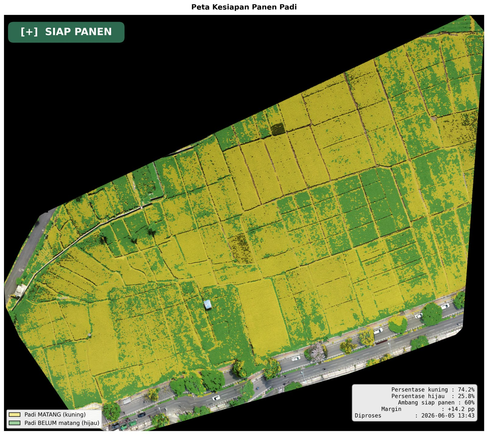

# Rice Classification API

Backend FastAPI untuk mendeteksi kesiapan panen padi dari foto drone. Foto digabung menjadi orthophoto lewat NodeODM, lalu setiap piksel padi diklasifikasikan sebagai matang (kuning) atau belum matang (hijau) dengan segmentasi warna HSV. Hasil akhirnya berupa verdict **SIAP PANEN** atau **BELUM SIAP PANEN**, peta GeoTIFF yang bisa dibuka di QGIS, dan statistik JSON.



Semua proses berjalan lokal di laptop tanpa layanan cloud. Antarmuka webnya ada di repo [rice-harvest-web](https://github.com/ryanmhildan/rice-harvest-web).

Dibuat sebagai bagian dari skripsi *Deteksi dan Pemetaan Kesiapan Panen Padi Menggunakan Citra Drone Berbasis Edge Computing dan Sistem Informasi Geografis (SIG)*, Teknik Informatika UNIKOM 2026.

## Cara kerja

```
Foto drone (JPG + EXIF GPS, overlap 70-80%)
  -> NodeODM: stitching menjadi orthophoto GeoTIFF
  -> Gaussian blur, CLAHE, konversi RGB ke HSV
  -> Threshold HSV: mask kuning dan mask hijau, dirapikan dengan morfologi
  -> Persentase kuning terhadap total piksel padi
  -> >= 60% SIAP PANEN, < 60% BELUM SIAP PANEN
  -> Ekspor GeoTIFF, PNG, dan JSON
```

Stitching bisa memakan waktu 10 menit sampai beberapa jam tergantung jumlah foto, jadi dijalankan sebagai job asinkron yang statusnya di-polling. Klasifikasi sendiri biasanya selesai di bawah satu menit.

### Parameter

Nilai di bawah ini ada di `services/classification.py` dan sudah dikalibrasi untuk citra sawah. Hue memakai skala OpenCV (0 sampai 179).

| Parameter | Nilai |
|---|---|
| Kuning (matang), H/S/V | `[20, 60, 60]` sampai `[34, 255, 255]` |
| Hijau (belum matang), H/S/V | `[35, 40, 40]` sampai `[85, 255, 255]` |
| Kernel Gaussian blur | 5 |
| CLAHE clip limit / tile | 2.0 / 8 |
| Kernel morfologi | 5 |
| Ambang siap panen | 0.60 (bisa diubah per request) |
| Resolusi orthophoto ODM | 5 cm/px |

Rentang hue kuning dan hijau sengaja tidak beririsan. Sisa tumpang tindih yang muncul setelah operasi closing diselesaikan berdasarkan nilai hue piksel.

## Menjalankan

Prasyarat:

- Python 3.12 (minimal 3.10)
- Docker Desktop
- Windows: Microsoft C++ Build Tools jika instalasi `rasterio` gagal

**1. NodeODM**

```bash
docker run -d -p 3000:3000 --name nodeodm opendronemap/nodeodm
```

Setelah container pertama kali dibuat, cukup `docker start nodeodm`. Cek di http://localhost:3000.

**2. Backend**

```bash
git clone https://github.com/ryanmhildan/rice_classification_api.git
cd rice_classification_api
python -m venv venv
venv\Scripts\activate
pip install -r requirements.txt
uvicorn api:app --host 0.0.0.0 --port 8000 --reload
```

Di Windows langkah di atas sudah dibungkus dalam `setup_environment.bat` (sekali saja) dan `start_api.bat`.

Swagger UI tersedia di http://localhost:8000/docs.


Database SQLite untuk riwayat per lahan (`rice_harvest.db`) dibuat otomatis di folder induk repo saat pertama kali dijalankan.

## Endpoint

| Method | Path | Fungsi |
|---|---|---|
| GET | `/health` | Health check backend |
| GET | `/nodeodm/status` | Cek koneksi ke NodeODM |
| POST | `/jobs/stitch` | Upload foto (min. 4) dan mulai stitching |
| GET | `/jobs/{job_id}` | Status job stitching |
| POST | `/jobs/{job_id}/classify` | Klasifikasi orthophoto hasil job |
| POST | `/classify` | Klasifikasi orthophoto yang sudah ada di disk |
| POST | `/upload-manual` | Upload orthophoto GeoTIFF (dan PNG klasifikasi opsional) yang diproses di luar sistem |
| GET | `/results` | Daftar semua hasil |
| GET | `/files/{kategori}/{nama_file}` | Unduh file output |
| GET | `/api/lahan` | Daftar lahan |
| GET | `/api/lahan/{id_lahan}/riwayat` | Riwayat deteksi satu lahan |
| GET | `/api/riwayat` | Semua riwayat deteksi |

Format request dan response lengkap ada di [BACKEND_API.md](BACKEND_API.md).

Contoh alur lewat curl:

```bash
curl -X POST http://localhost:8000/jobs/stitch \
  -F "images=@DJI_0001.JPG" -F "images=@DJI_0002.JPG" \
  -F "images=@DJI_0003.JPG" -F "images=@DJI_0004.JPG"
# {"job_id": "abc123", "status": "queued", ...}

curl http://localhost:8000/jobs/abc123
# ulangi sampai status "completed"

curl -X POST "http://localhost:8000/jobs/abc123/classify?threshold=0.60"
# {"verdict": "SIAP PANEN", "yellow_pct_of_rice": 74.23, ...}
```

## CLI

Pipeline juga bisa dijalankan tanpa server:

```bash
python pipeline.py check-nodeodm
python pipeline.py classify --ortho path/ke/orthophoto.tif --output output
python pipeline.py full --images data/drone_images --output output
```

Tambahkan `--json-only` untuk mencetak hasil sebagai JSON saja.

## Output

Setiap klasifikasi menulis ke folder `output/` (tidak ikut di-commit):

| Folder | Isi |
|---|---|
| `orthophoto/` | Orthophoto GeoTIFF hasil ODM |
| `classification/` | GeoTIFF 1 band berisi kelas per piksel |
| `orthophoto_web/`, `classification_web/` | PNG RGBA untuk overlay Leaflet |
| `visualization/` | Peta komposit PNG 300 DPI untuk laporan |
| `results/` | JSON berisi verdict, persentase, CRS, dan bounds |

## Testing

```bash
python sample_test.py       # cek instalasi dengan data dummy, tanpa NodeODM
python smoke_test_api.py    # uji endpoint, butuh API dan NodeODM aktif
```

## Struktur

```
api.py               definisi endpoint FastAPI
routes_riwayat.py    endpoint /api untuk riwayat per lahan
database.py, models.py, crud.py   SQLite via SQLModel
pipeline.py          CLI
services/
  stitching.py       wrapper PyODM ke NodeODM
  classification.py  pra-pemrosesan, segmentasi HSV, ekspor
```

## Troubleshooting

| Masalah | Solusi |
|---|---|
| `Cannot connect to NodeODM` | Nyalakan Docker Desktop lalu `docker start nodeodm` |
| `ModuleNotFoundError: services` | Jalankan uvicorn dari dalam folder repo |
| ODM gagal karena fitur tidak cukup | Pastikan overlap foto 70-80% |
| `WinError 32` saat stitching | File dikunci OneDrive atau antivirus. Pindahkan proyek keluar dari folder yang tersinkron OneDrive |
| CORS error dari frontend | Tambahkan origin di `allow_origins` pada `api.py` |

## Lisensi

Dibuat untuk keperluan skripsi. Silakan gunakan sebagai referensi akademis.
