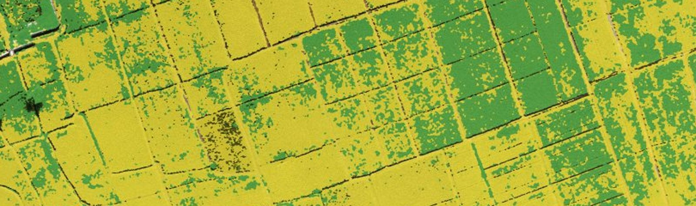
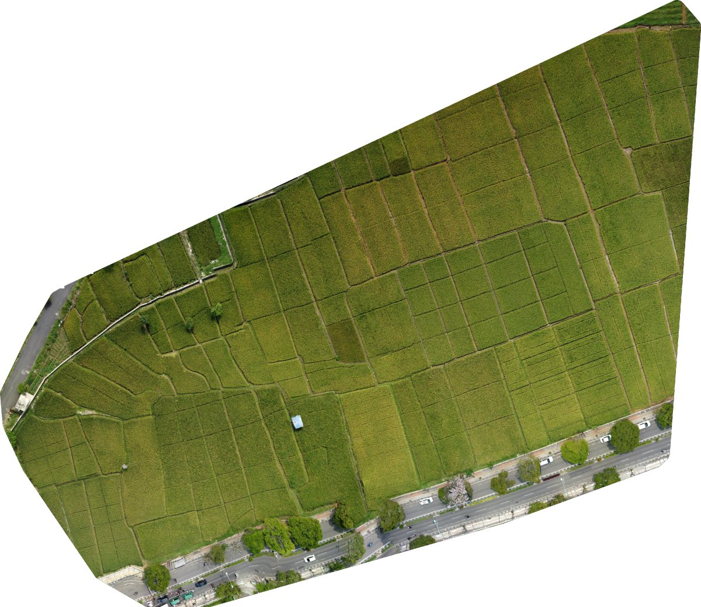
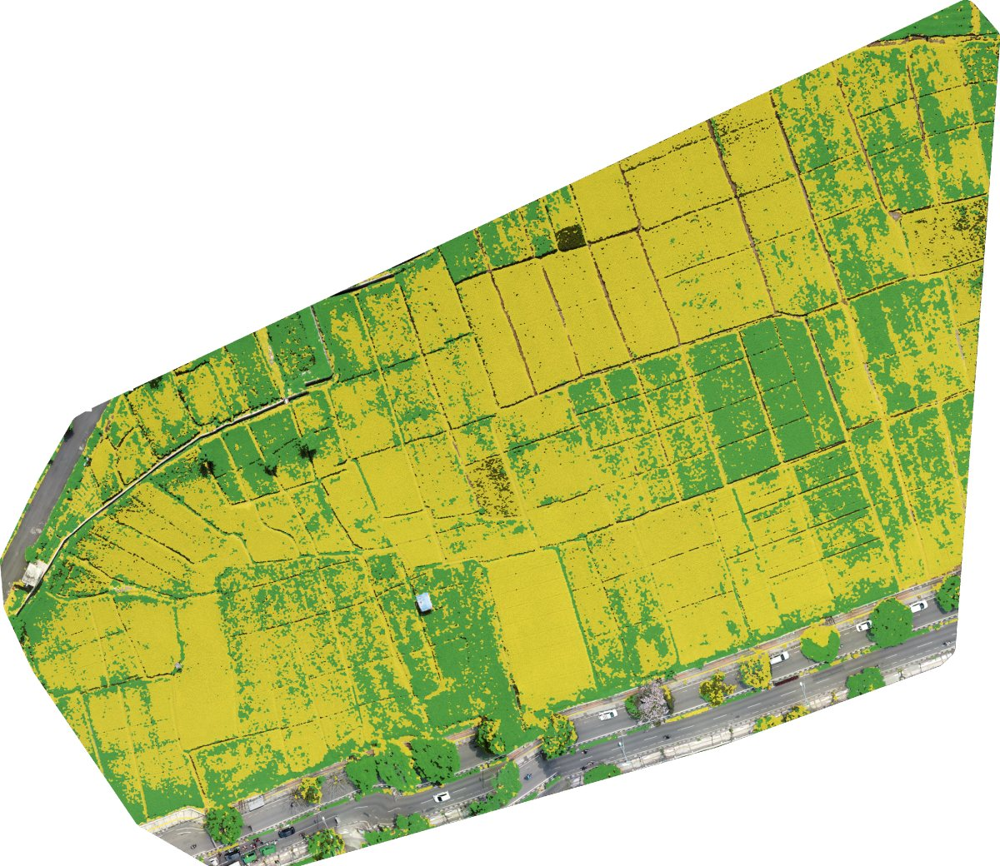
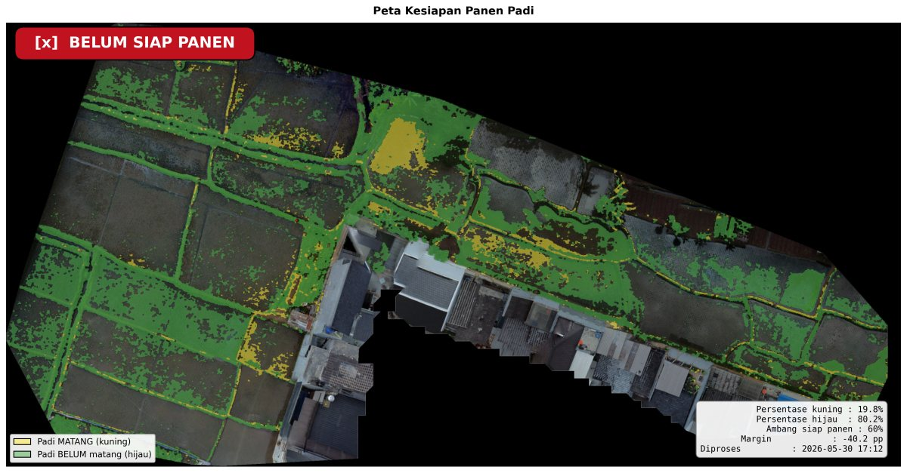
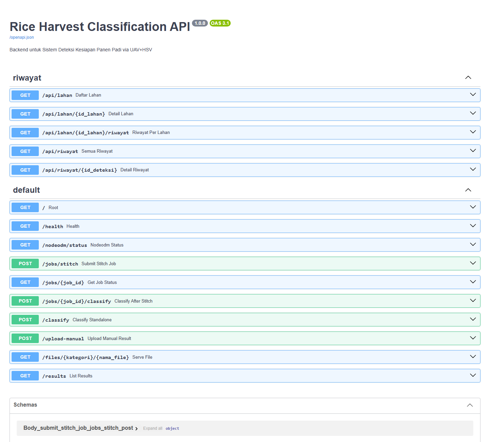

<p align="center">
  
</p>

<div align="center">

[](requirements.txt)
[](requirements.txt)
[](requirements.txt)
[](requirements.txt)
[](https://github.com/OpenDroneMap/NodeODM)
[](#tentang)

# Rice Classification API

### Backend yang mengubah foto drone sawah menjadi verdict siap panen dan peta GeoTIFF.

**Offline dari awal sampai akhir.** Stitching, segmentasi, dan ekspor berjalan di satu laptop, tanpa layanan cloud.

**[Frontend](https://github.com/ryanmhildan/rice-harvest-web) · [Kontrak API](BACKEND_API.md) · [Swagger lokal](http://localhost:8000/docs)**

[Hasil](#hasil) · [Cara kerja](#cara-kerja) · [Menjalankan](#menjalankan) · [Endpoint](#endpoint) · [FAQ](#faq)

<code>uvicorn api:app --port 8000</code>

</div>

---

## Hasil

### Orthophoto dan klasifikasi

Satu lahan, dua tahap. Di kiri orthophoto hasil stitching NodeODM, di kanan setiap piksel padi sudah diberi kelas: kuning untuk matang, hijau untuk belum matang.

| **Orthophoto** | **Klasifikasi** |
|:--|:--|
| <a href="docs/screenshots/orthophoto.jpg"></a> | <a href="docs/screenshots/klasifikasi.jpg"></a> |
| Orthophoto GeoTIFF ber-georeferensi, resolusi target 5 cm/px. | Overlay kelas dari segmentasi HSV, juga diekspor sebagai GeoTIFF 1 band. |

### Dua verdict

Persentase kuning terhadap total piksel padi dibandingkan dengan ambang 60%.

| **SIAP PANEN** | **BELUM SIAP PANEN** |
|:--|:--|
| <a href="docs/screenshots/siap-panen.jpg"></a> | <a href="docs/screenshots/belum-siap.jpg"></a> |
| 74,2% kuning, 14,2 poin di atas ambang. | 19,8% kuning, sebagian besar petak masih hijau atau baru tanam. |

Peta di atas adalah PNG 300 DPI yang dihasilkan otomatis di `output/visualization/`. Klik gambar untuk ukuran penuh.

## Cara kerja

```
Foto drone (JPG + EXIF GPS, overlap 70-80%)
  -> NodeODM: stitching menjadi orthophoto GeoTIFF
  -> Gaussian blur, CLAHE, konversi RGB ke HSV
  -> Threshold HSV: mask kuning dan mask hijau, dirapikan dengan morfologi
  -> Persentase kuning terhadap total piksel padi
  -> >= 60% SIAP PANEN, < 60% BELUM SIAP PANEN
  -> Ekspor GeoTIFF, PNG, dan JSON
```

- **Stitching** berjalan sebagai job asinkron karena bisa memakan 10 menit sampai beberapa jam. Statusnya di-polling lewat `GET /jobs/{job_id}`.
- **Klasifikasi** biasanya selesai di bawah satu menit, jadi dijalankan langsung dalam satu request.
- **Verdict** dihitung untuk seluruh orthophoto, bukan per petak.

### Parameter

Nilai ada di `services/classification.py` dan sudah dikalibrasi untuk citra sawah. Hue memakai skala OpenCV (0 sampai 179).

| Parameter | Nilai |
|-----------|-------|
| Kuning (matang), H/S/V | `[20, 60, 60]` sampai `[34, 255, 255]` |
| Hijau (belum matang), H/S/V | `[35, 40, 40]` sampai `[85, 255, 255]` |
| Kernel Gaussian blur | 5 |
| CLAHE clip limit / tile | 2.0 / 8 |
| Kernel morfologi | 5 |
| Ambang siap panen | 0.60, bisa diubah per request |
| Resolusi orthophoto ODM | 5 cm/px |

Rentang hue kuning dan hijau sengaja tidak beririsan. Sisa tumpang tindih setelah operasi closing diselesaikan berdasarkan nilai hue tiap piksel.

## Menjalankan

### Prasyarat

- Python 3.12 (minimal 3.10)
- Docker Desktop
- Windows: Microsoft C++ Build Tools kalau instalasi `rasterio` gagal

### NodeODM

```bash
docker run -d -p 3000:3000 --name nodeodm opendronemap/nodeodm
```

Setelah container dibuat, cukup `docker start nodeodm`. Cek di http://localhost:3000.

### Backend

```bash
git clone https://github.com/ryanmhildan/rice_classification_api.git
cd rice_classification_api
python -m venv venv
venv\Scripts\activate
pip install -r requirements.txt
uvicorn api:app --host 0.0.0.0 --port 8000 --reload
```

Di Windows, langkah instalasi sudah dibungkus dalam `setup_environment.bat` (sekali saja) dan server dalam `start_api.bat`.

Database SQLite untuk riwayat per lahan (`rice_harvest.db`) dibuat otomatis di folder induk repo saat pertama kali dijalankan.

### CLI

Pipeline juga bisa dijalankan tanpa server:

```bash
python pipeline.py check-nodeodm
python pipeline.py classify --ortho path/ke/orthophoto.tif --output output
python pipeline.py full --images data/drone_images --output output
```

Tambahkan `--json-only` untuk mencetak hasil sebagai JSON saja.

## Endpoint

<a href="docs/screenshots/swagger.png"></a>

| Method | Path | Fungsi |
|--------|------|--------|
| GET | `/health` | Health check backend |
| GET | `/nodeodm/status` | Cek koneksi ke NodeODM |
| POST | `/jobs/stitch` | Upload foto (min. 4) dan mulai stitching |
| GET | `/jobs/{job_id}` | Status job stitching |
| POST | `/jobs/{job_id}/classify` | Klasifikasi orthophoto hasil job |
| POST | `/classify` | Klasifikasi orthophoto yang sudah ada di disk |
| POST | `/upload-manual` | Upload orthophoto GeoTIFF (dan PNG klasifikasi opsional) yang diproses di luar sistem |
| GET | `/results` | Daftar semua hasil |
| GET | `/files/{kategori}/{nama_file}` | Unduh file output |
| GET | `/api/lahan` | Daftar lahan |
| GET | `/api/lahan/{id_lahan}/riwayat` | Riwayat deteksi satu lahan |
| GET | `/api/riwayat` | Semua riwayat deteksi |

Format request dan response lengkap ada di [BACKEND_API.md](BACKEND_API.md).

```bash
curl -X POST http://localhost:8000/jobs/stitch \
  -F "images=@DJI_0001.JPG" -F "images=@DJI_0002.JPG" \
  -F "images=@DJI_0003.JPG" -F "images=@DJI_0004.JPG"
# {"job_id": "abc123", "status": "queued", ...}

curl http://localhost:8000/jobs/abc123
# ulangi sampai status "completed"

curl -X POST "http://localhost:8000/jobs/abc123/classify?threshold=0.60"
# {"verdict": "SIAP PANEN", "yellow_pct_of_rice": 74.23, ...}
```

### Output

Setiap klasifikasi menulis ke `output/` (tidak ikut di-commit):

| Folder | Isi |
|--------|-----|
| `orthophoto/` | Orthophoto GeoTIFF hasil ODM |
| `classification/` | GeoTIFF 1 band berisi kelas per piksel |
| `orthophoto_web/`, `classification_web/` | PNG RGBA untuk overlay Leaflet |
| `visualization/` | Peta komposit PNG 300 DPI untuk laporan |
| `results/` | JSON berisi verdict, persentase, CRS, dan bounds |

## Testing

```bash
python sample_test.py       # cek instalasi dengan data dummy, tanpa NodeODM
python smoke_test_api.py    # uji endpoint, butuh API dan NodeODM aktif
```

## FAQ

**Kenapa HSV, bukan model deep learning?**
Kematangan padi terlihat jelas dari pergeseran warna kanopi dari hijau ke kuning. Segmentasi HSV cukup untuk menangkap itu, jalan cepat di laptop tanpa GPU, dan setiap keputusannya bisa dijelaskan dari angka threshold.

**Bisa dibuka di QGIS?**
Bisa. Orthophoto dan GeoTIFF klasifikasi sudah ber-georeferensi, jadi langsung jatuh di posisi yang benar.

**`Cannot connect to NodeODM`.**
Docker Desktop belum jalan atau container mati. Nyalakan Docker lalu `docker start nodeodm`.

**ODM gagal karena fitur tidak cukup.**
Overlap antarfoto terlalu kecil. Terbangkan ulang dengan overlap 70-80%.

**`WinError 32` saat stitching.**
File sedang dikunci OneDrive atau antivirus. Pindahkan proyek keluar dari folder yang tersinkron OneDrive, misalnya ke `C:\skripsi\`.

<hr>

<p align="center"><em>Sistem ini membaca warna kanopi, bukan kadar air gabah.<br>
Hasilnya alat bantu keputusan, bukan pengganti petani yang turun ke sawah.</em></p>

<hr>

## Tentang

Bagian dari skripsi *Deteksi dan Pemetaan Kesiapan Panen Padi Menggunakan Citra Drone Berbasis Edge Computing dan Sistem Informasi Geografis (SIG)*, Teknik Informatika UNIKOM 2026, oleh Ryan Muhammad Hildan.

## Lisensi

Dibuat untuk keperluan skripsi. Silakan gunakan sebagai referensi akademis dengan mencantumkan sumber.
